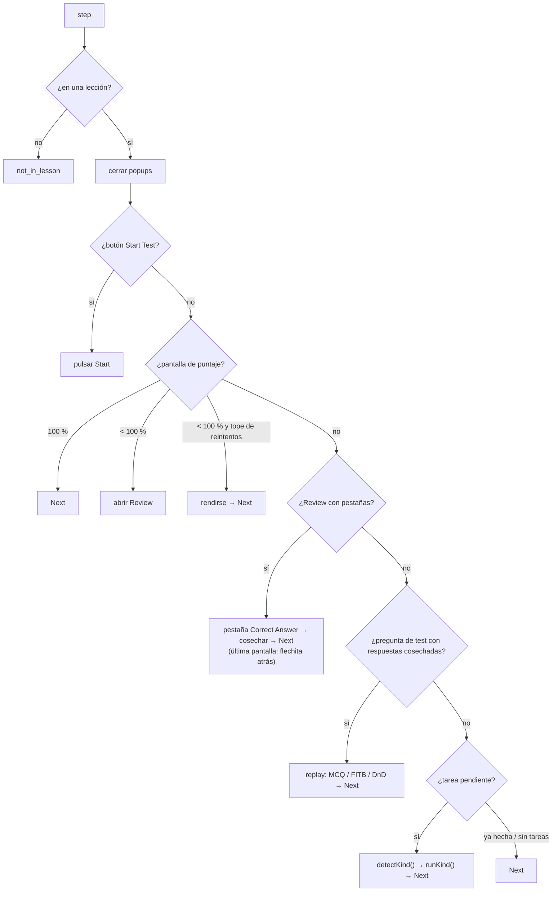

# Arquitectura

## Un "paso" del bot (`MainEngine.step()`)

`__ed.auto()` repite `step()` cada `CFG.tickMs` ms. Cada paso hace **una** cosa:

## Archivos y dependencias

| Capa | Archivos | Usa |
|---|---|---|
| Base | `bootstrap.js`, `core/config.js`, `utils/*` | — |
| Estado y navegación | `core/storage.js`, `core/navigation.js` | base |
| Ejercicios | `exercises/*.js` → `exercises/index.js` (`PracticeSolver`) | base + navegación |
| Tests | `tests/test-manager.js` | todo lo anterior + `PracticeSolver` |
| Motor | `core/engine.js` | todo |
| Interfaz | `ui/console-api.js`, `ui/hud.js`, `main.js` | motor |

`build.js` los concatena en ese orden (lista `ORDEN`). No hay módulos ES: es el mismo script de siempre, partido en archivos para poder tocar uno sin ver los demás.

## Datos guardados (localStorage)

| Clave | Contenido |
|---|---|
| `ed:cfg:v18.11` | configuración (`__ed.cfg`) |
| `ed:answers:v1` | MCQ: texto de pregunta → respuesta(s) |
| `ed:testAns:v2` | por test (`lección‖step`) y por pantalla (`1`, `2`…): `{mcq, fitb, dnd}` |
| `ed:testKnown:v1` | tests ya cosechados |
| `ed:testScores:v1` | último puntaje visto por test |
| `ed:testRun:v1` | test en curso (`phase: review / replay`) |

## Por qué así y no Vite/npm

- El resultado tiene que pegarse en la consola: un solo archivo, sin módulos.
- Convertir a `import/export` obligaba a reescribir referencias en todo el código (riesgo de romper lo que funciona). Concatenar mantiene cada línea igual: `npm test` comprobó que v20.0 hace exactamente lo mismo que v19.7.
- `build.js` no necesita instalar nada; `jsdom` solo se usa para las pruebas.
